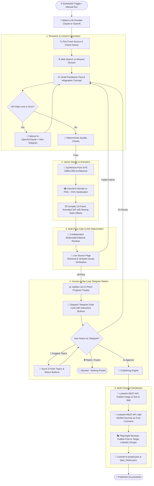

# 🚀 Autonomous LinkedIn Technical Publisher & AI Agent

<div align="center">


-success?style=for-the-badge&logo=pytest&logoColor=white)

<p align="center">
  <b>An enterprise-grade, human-in-the-loop autonomous AI agent that discovers, researches, writes, illustrates, verifies, and distributes publication-quality software engineering posts to LinkedIn.</b>
</p>

</div>

---

## 📑 Table of Contents

- [🌟 System Overview](#-system-overview)
- [🏗️ Architectural Pipeline & Data Flow](#️-architectural-pipeline--data-flow)
- [✨ Core Capabilities](#-core-capabilities)
  - [1. 🧠 Dual-Model Rotation & Bidirectional Failover](#1--dual-model-rotation--bidirectional-failover)
  - [2. 🎨 1080×1350 Technical Infographics & Animated GIFs](#2--10801350-technical-infographics--animated-gifs)
  - [3. 🛡️ Deterministic Quality Gates & Anti-Hallucination Fact-Checking](#3-️-deterministic-quality-gates--anti-hallucination-fact-checking)
  - [4. 📲 Telegram Command Center & Live Progress Tracking](#4--telegram-command-center--live-progress-tracking)
  - [5. 🌐 Multi-Channel Distribution (Personal Wall + Groups)](#5--multi-channel-distribution-personal-wall--groups)
- [📂 Codebase Architecture & File Manifest](#-codebase-architecture--file-manifest)
- [⚙️ Configuration Guide (`config.yaml`)](#️-configuration-guide-configyaml)
- [🚀 Quickstart & Setup Guide](#-quickstart--setup-guide)
  - [Step 1: Environment & Virtualenv](#step-1-environment--virtualenv)
  - [Step 2: Anthropic & OpenAI API Keys](#step-2-anthropic--openai-api-keys)
  - [Step 3: Telegram Bot Setup](#step-3-telegram-bot-setup)
  - [Step 4: LinkedIn REST API OAuth Setup](#step-4-linkedin-rest-api-oauth-setup)
  - [Step 5: LinkedIn Groups Browser Session Setup](#step-5-linkedin-groups-browser-session-setup)
- [🤖 Telegram Bot Commands & Mobile Controls](#-telegram-bot-commands--mobile-controls)
- [⏱️ Deployment Options](#️-deployment-options)
  - [Option A: 100% Free Serverless GitHub Actions Cron](#option-a-100-free-serverless-github-actions-cron)
  - [Option B: Native macOS LaunchAgent Daemon](#option-b-native-macos-launchagent-daemon)
  - [Option C: 24/7 Telegram Command Daemon](#option-c-247-telegram-command-daemon)
- [🧪 Testing & Quality Assurance](#-testing--quality-assurance)
- [🔒 Security & Compliance](#-security--compliance)

---

## 🌟 System Overview

Publishing consistent, high-signal technical content on LinkedIn requires extensive research, crisp writing, clean typography, engaging architecture diagrams, and community distribution. 

The **LinkedIn Post Agent** automates this entire lifecycle autonomously while preserving strict human editorial control:

```
┌────────────────────────────────────────────────────────────────────────────────────────┐
│                                 AUTONOMOUS AGENT PIPELINE                               │
├─────────────────────┬──────────────────────┬─────────────────────┬─────────────────────┤
│ 1. RESEARCH & SCOUT │ 2. WRITE & ILLUSTRATE│ 3. RIGID VERIFY     │ 4. HUMAN CONSENT    │
│  • Allowed sources  │  • Practitioner voice│  • Deterministic chk│  • Telegram review  │
│  • Deduplication db │  • 1080x1350 pure SVG│  • 3 LLM reviews    │  • One-tap approval │
│  • Claude / GPT-4o  │  • 12-frame loop GIF │  • Live fact check  │  • Live progress    │
└──────────┬──────────┴───────────┬──────────┴──────────┬──────────┴──────────┬──────────┘
           │                      │                     │                     │
           ▼                      ▼                     ▼                     ▼
┌────────────────────────────────────────────────────────────────────────────────────────┐
│ 5. MULTI-CHANNEL PUBLISHING: Personal Wall API + First Comment + Groups (Playwright)   │
└────────────────────────────────────────────────────────────────────────────────────────┘
```

> [!IMPORTANT]
> **No content is ever published without explicit human authorization.** The agent delivers an interactive review card to your private Telegram bot, complete with high-resolution visual previews and actionable buttons. Tapping **Approve** immediately triggers multi-channel publishing.

---

## 🏗️ Architectural Pipeline & Data Flow

Below is the complete state and execution machine of the agent:



---

## ✨ Core Capabilities

### 1. 🧠 Dual-Model Rotation & Bidirectional Failover

Never miss a publishing window due to API limits or credit exhaustion:
* **Configurable Strategy:** Set `model_strategy: "random"` to automatically alternate between Anthropic Claude 3.5 Sonnet and OpenAI GPT-4o, or lock to your preferred provider.
* **Mid-Flight Failover:** If Claude encounters rate limits (`429`), credit exhaustion, or service overload (`529`), the agent seamlessly transitions to OpenAI GPT-4o / o1 / o3.
* **Instant Alerts:** Sends a real-time notification to Telegram whenever a failover occurs, keeping you informed.

### 2. 🎨 1080×1350 Technical Infographics & Animated GIFs

Static text posts get lost in feeds; high-density architectural diagrams capture attention:
* **Pure SVG Synthesis:** Renders standard 1080×1350 portrait graphics designed specifically for LinkedIn mobile feeds.
* **Publication Layouts:** Supports Dual Comparative Panels (e.g., *RAG vs. Agentic RAG*), Split-Screen Architectural Comparisons, and Central Execution Loop diagrams.
* **12-Frame Looping Animated GIFs:** Dynamically calculates SVG `stroke-dasharray="10 10"` and offsets dash patterns frame-by-frame, creating a looping visualization of live streaming data.
* **Spatial Guardrails:** Enforces minimum 22px font sizes, explicit element padding, strict collision avoidance, and zero emojis inside vector text.

```
┌────────────────────────────────────────────────────────┐
│  1080 x 1350 PORTRAIT TECHNICAL INFOGRAPHIC            │
│ ┌────────────────────────────────────────────────────┐ │
│ │ 🎯 Title: Autonomous Multi-Agent Architecture      │ │
│ └────────────────────────────────────────────────────┘ │
│ ┌──────────────────────┐      ┌──────────────────────┐ │
│ │  Client / Gateway    │      │  Orchestrator Hub    │ │
│ │  • Auth & Validation │ ────▶│  • Context Router    │ │
│ └──────────────────────┘      └──────────┬───────────┘ │
│                                          │             │
│              Animated Streaming Wires   ▼             │
│        - - - - - - - - - - - - - - - - - - - - - -     │
│ ┌──────────────────────┐      ┌──────────────────────┐ │
│ │  Vector DB / Memory  │      │  Sub-Agents & Tools  │ │
│ │  • Semantic Search   │      │  • Code / Execution  │ │
│ └──────────────────────┘      └──────────────────────┘ │
│ ────────────────────────────────────────────────────── │
│ 🏷️ Curated by Guhaprasaanth                            │
└────────────────────────────────────────────────────────┘
```

### 3. 🛡️ Deterministic Quality Gates & Anti-Hallucination Fact-Checking

Eliminates repetitive buzzwords, invalid formatting, and hallucinations through layered defenses:

| Layer | Validator | Responsibility |
| :--- | :--- | :--- |
| **Layer 1** | `hard_checks()` | Enforces 1,000–1,500 character boundaries, detects repeated words ("the the"), prevents adjacent emojis, and purges JSON artifacts. |
| **Layer 2** | `duplicate_topic()` | Tokenizes titles and takeaways into stem sets, calculating Jaccard similarity against `topic_history.json` to prevent repeating subjects. |
| **Layer 3** | `svg_checks()` | Scans generated SVGs for raw XML errors, unauthorized external imports, XSS vectors, and minimum font size violations. |
| **Layer 4** | `editorial_review()` | 3 independent multimodal LLM reviewers grade readability, technical depth, and image alignment (each category must score $\ge 4/5$). |
| **Layer 5** | `fact_check()` | Fetches cited web pages via SSRF-safe HTTP requests and verifies that every factual claim is backed by an exact quote. |

### 4. 📲 Telegram Command Center & Live Progress Tracking

Review and command your agent directly from your mobile device via Telegram:

* **Live In-Place Progress Tracker:** Sends a single progress message that updates in real-time (`[1/4] Researching...` $\rightarrow$ `[2/4] Drafting...` $\rightarrow$ `[3/4] Rendering...` $\rightarrow$ `[4/4] Editorial approval passed!`).
* **Interactive Inline Action Center:**
  * `[👍 Approve & Publish]`: Posts immediately to LinkedIn feed and groups.
  * `[✍️ Revise with Notes]`: Prompts you for feedback and redrafts the post accordingly.
  * `[💡 Suggest Topics]`: Discovers 3 fresh technical topics and lets you pick with a single tap.
  * `[❌ Skip / Reject]`: Cancels the draft without posting.
* **Auto-Reminder Daemon:** Dispatches reminder pings every 20 minutes if a draft is awaiting approval, expiring safely after 3 hours.
* **Anti-Double-Posting Protection:** Inline buttons transition to an inert `[✅ Posted]` or `[❌ Cancelled]` state upon click, preventing duplicate triggers.

### 5. 🌐 Multi-Channel Distribution (Personal Wall + Groups)

* **Personal LinkedIn Wall:** Uses the official LinkedIn REST API (Restli 2.0) with direct image upload (`images?action=initializeUpload`) and structured text payloads.
* **Source Attribution:** Automatically posts cited documentation URLs as the first comment on your publication to keep the main post clean and boost feed reach.
* **Target LinkedIn Groups:** Uses headless Playwright browser automation with persistent session authentication, navigating to each group in your config, entering the text, attaching the image, and publishing with anti-bot delays.

---

## 📂 Codebase Architecture & File Manifest

```
.
├── .github/
│   └── workflows/
│       └── daily-post.yml         # 100% Free daily cron pipeline for GitHub Actions
├── tests/                         # Comprehensive pytest test suite (85 tests, 100% unit coverage)
│   ├── test_agent_helpers.py      # Tests for JSON extraction, emojis, domains, and checks
│   ├── test_agent_pipeline.py     # Tests for writer, designer, reviewer, and direct post flows
│   ├── test_infographic.py        # Tests for SVG checks, PNG rendering, and animated GIFs
│   ├── test_linkedin.py           # Tests for LinkedIn API client, headers, and media uploads
│   ├── test_model_selection_and_fallback.py # Tests for model rotation & Telegram alerts
│   ├── test_quality.py            # Tests for deduplication, SSRF checks, and source quotes
│   └── test_telegram_review.py   # Tests for Telegram draft state machine & authorization
├── agent.py                       # Central orchestrator: research, write, review, publish
├── config.yaml                    # System configuration: author voice, models, limits, groups
├── infographic.py                 # Pure SVG generation, CairoSVG rendering, and GIF animations
├── linkedin.py                    # LinkedIn REST API client for personal feed publishing
├── linkedin_auth.py               # Local OAuth 2.0 callback server for token generation
├── linkedin_groups.py             # Playwright automation for LinkedIn group distribution
├── quality.py                     # Deterministic quality checks, SSRF guards, and deduplication
├── setup_mac_scheduler.sh         # Native macOS launchd LaunchAgent installation script
├── telegram_review.py             # Telegram bot interaction, inline keyboards, and reminders
├── posted.json                    # Historical database of published posts and LinkedIn URNs
├── topic_history.json             # Deduplication database of proposed and approved topics
└── requirements.txt               # Python package dependencies
```

---

## ⚙️ Configuration Guide (`config.yaml`)

Customizing the agent is simple via `config.yaml`:

```yaml
# -----------------------------------------------------------------------------
# AUTHOR PERSONA & VOICE
# -----------------------------------------------------------------------------
author:
  name: "Guhaprasaanth"
  role: "Lead Software Architect"
  voice: "Pragmatic, high-signal, practitioner-focused. Prefers concrete code, architecture tradeoffs, and limitations over generic buzzwords."

# -----------------------------------------------------------------------------
# AI MODEL CONFIGURATION
# -----------------------------------------------------------------------------
model_strategy: "random"          # Options: 'random' | 'anthropic' | 'openai'
model: "claude-3-5-sonnet-20241022" # Primary Anthropic model
openai_fallback_model: "gpt-4o"  # Fallback/alternative OpenAI model
reasoning_effort: "medium"        # Reasoning effort for o1/o3 models ('low' | 'medium' | 'high')

# -----------------------------------------------------------------------------
# RESEARCH & CURATED SOURCES
# -----------------------------------------------------------------------------
research:
  skip_recent_days: 4             # Do not reuse sources used in the last 4 days
  evergreen_share: 0.4            # Ratio of evergreen engineering concepts vs. fresh release notes
  allowed_domains:
    - react.dev/blog
    - developer.mozilla.org
    - web.dev/blog
    - python.org/blogs
    - nextjs.org/blog
    - bun.sh/blog
    - tailwindcss.com/blog

# -----------------------------------------------------------------------------
# LINKEDIN POST RULES
# -----------------------------------------------------------------------------
post:
  min_chars: 1000
  max_chars: 1500
  min_emojis: 3
  max_emojis: 6
  hashtags: 5

# -----------------------------------------------------------------------------
# EDITORIAL REVIEW THRESHOLDS
# -----------------------------------------------------------------------------
review:
  passes: 3                       # Number of independent editorial review passes
  min_score: 4                    # Minimum required score per category (out of 5)
  max_attempts: 3                 # Maximum drafting retries before pausing

# -----------------------------------------------------------------------------
# MULTI-CHANNEL DISTRIBUTION
# -----------------------------------------------------------------------------
linkedin:
  api_version: "202401"
  group_delay_seconds: 14         # Anti-spam delay between group postings
  target_groups:
    - "https://www.linkedin.com/groups/1234567/"
    - "https://www.linkedin.com/groups/7654321/"

# -----------------------------------------------------------------------------
# TELEGRAM NOTIFICATIONS
# -----------------------------------------------------------------------------
telegram:
  timeout_hours: 3                # Draft expiry window
  remind_every_minutes: 20        # Reminder interval while awaiting approval
```

---

## 🚀 Quickstart & Setup Guide

### Step 1: Environment & Virtualenv

Ensure you have Python 3.12+ installed. Install system graphics libraries (`cairo`) and project dependencies:

```bash
# macOS
brew install cairo pkg-config

# Ubuntu / Debian Linux
sudo apt-get install -y libcairo2 pkg-config fonts-dejavu-core

# Set up virtual environment
python3 -m venv .venv
source .venv/bin/activate
pip install -r requirements.txt

# Install Playwright browser binaries
playwright install --with-deps chromium
```

### Step 2: Anthropic & OpenAI API Keys

Create a `.env` file in the project root:

```bash
cp .env.example .env
```

Add your API credentials:

```ini
ANTHROPIC_API_KEY="sk-ant-..."
OPENAI_API_KEY="sk-proj-..."
```

### Step 3: Telegram Bot Setup

1. Open Telegram and search for [@BotFather](https://t.me/BotFather).
2. Send `/newbot`, name your bot, and copy the provided API token into `TELEGRAM_BOT_TOKEN`.
3. Open your newly created bot in Telegram and tap **Start** (or send any text).
4. Run the helper tool to retrieve your unique chat ID:
   ```bash
   python telegram_review.py --find-chat-id
   ```
5. Paste the returned integer into `TELEGRAM_CHAT_ID` in `.env`.
6. Configure the Telegram bot menu commands and profile description:
   ```bash
   python agent.py --setup-bot
   ```

### Step 4: LinkedIn REST API OAuth Setup

1. Go to the [LinkedIn Developer Portal](https://www.linkedin.com/developers/apps) and create an application.
2. In the **Products** tab, add:
   * **Share on LinkedIn**
   * **Sign In with LinkedIn using OpenID Connect**
3. In the **Auth** tab:
   * Add redirect URL: `http://localhost:8765/callback`
   * Copy **Client ID** and **Client Secret** into your `.env` file (`LINKEDIN_CLIENT_ID`, `LINKEDIN_CLIENT_SECRET`).
4. Generate your 60-day OAuth 2.0 access token by running the local authorization server:
   ```bash
   python linkedin_auth.py
   ```
   *Your browser will open automatically. Sign in, click **Allow**, and the access token will be saved to your `.env` file.*

### Step 5: LinkedIn Groups Browser Session Setup

For automated group publishing via Playwright:
1. Export your LinkedIn session cookie (`li_at`) from your browser using your browser's Developer Tools or an extension like *Cookie-Editor*.
2. Paste the cookie value into `.env`:
   ```ini
   LI_AT="AQED..."
   ```

---

## 🤖 Telegram Bot Commands & Mobile Controls

When running the daemon (`python agent.py --listen`), your Telegram bot functions as a mobile content studio:

| Command | Action | Example |
| :--- | :--- | :--- |
| `/daily` | Triggers the full autonomous daily research, drafting, and illustration pipeline. | `/daily` |
| `/topic <query>` | Researches and produces a post specifically about the requested topic. | `/topic React 19 Actions vs Server Functions` |
| `/direct <text>` | Takes your raw text, auto-generates a matching technical infographic, and prepares it for publishing. | `/direct Just released our new open source tool...` |
| `/suggest` | Scouts 3 fresh, verified technical ideas and presents them as one-tap buttons. | `/suggest` |
| `/status` | Returns a live summary of recent posts, target groups, and active AI models. | `/status` |
| `/help` | Displays command documentation and usage tips. | `/help` |

> [!TIP]
> **Mobile Photo Uploads:** Sending a photo directly to the bot with a caption automatically treats the caption as a post draft and attaches your photo for review and publishing!

---

## ⏱️ Deployment Options

### Option A: 100% Free Serverless GitHub Actions Cron

Run completely free on GitHub's infrastructure without maintaining a dedicated server:

1. Push this repository to a **Private** GitHub repository.
2. Go to **Settings** $\rightarrow$ **Secrets and variables** $\rightarrow$ **Actions** and add the repository secrets:
   * `ANTHROPIC_API_KEY`
   * `OPENAI_API_KEY`
   * `LINKEDIN_ACCESS_TOKEN`
   * `TELEGRAM_BOT_TOKEN`
   * `TELEGRAM_CHAT_ID`
   * `LI_AT`
3. The included workflow [`.github/workflows/daily-post.yml`](file:///.github/workflows/daily-post.yml) automatically triggers every morning at **9:15 AM America/New_York**.
4. The GitHub Actions runner generates the post, sends the review card to Telegram, and waits up to **4 hours** for your approval before publishing and committing the logs.

### Option B: Native macOS LaunchAgent Daemon

If you prefer running locally on your Mac, use the native LaunchAgent daemon script:

```bash
# Installs a native launchd service scheduled for 9:15 AM daily
./setup_mac_scheduler.sh 9 15
```

* **Sleep/Wake Resilient:** If your Mac is asleep at 9:15 AM, launchd automatically fires the job as soon as you open your laptop!
* Inspect live execution logs at any time:
  ```bash
  tail -f agent.log
  ```

### Option C: 24/7 Telegram Command Daemon

To keep the agent listening continuously for on-demand Telegram commands (`/topic`, `/direct`, `/suggest`):

```bash
# Run listener process (can be managed with tmux or systemd)
python agent.py --listen
```

---

## 🧪 Testing & Quality Assurance

The codebase includes an extensive unit test suite with 85 tests:

```bash
# Run all unit tests
pytest

# Run tests with code coverage report
pytest --cov=. tests/
```

### Test Coverage Highlights:
* **Infographic Module (`infographic.py`):** **100% Coverage** (SVG extraction, sanitization, minimum font size checks, Cairo rendering, streaming dash offset frame calculations).
* **LinkedIn Client (`linkedin.py`):** **100% Coverage** (Restli 2.0 headers, OpenID `userinfo`, media upload registration, multi-part binary streaming, and comment creation).
* **Telegram Reviewer (`telegram_review.py`):** Multi-step state machine testing, message chunking, authorized chat gating, and reminder triggers.
* **Anti-Hallucination & Quality (`quality.py`):** SSRF URL validation, Jaccard token deduplication, and source quote verification.
* **Failover Engine:** Multi-provider rotation, rate limit error trapping, and Telegram fallback alerts.

---

## 🔒 Security & Compliance

* **Strict SSRF Protection:** The source fetching engine (`quality.py`) validates IP ranges, strictly prohibiting requests to internal subnets, private ranges (`10.0.0.0/8`, `192.168.0.0/16`, `127.0.0.1`), and non-standard ports.
* **No Hardcoded Secrets:** All credentials, tokens, and cookies are read from `.env` and kept strictly out of git version control via `.gitignore`.
* **Authorized Chat Gating:** The Telegram bot strictly inspects `from.id` and `chat.id` on every inbound callback and message, ignoring inputs from unauthorized accounts.
* **Anti-Double-Posting Locks:** Every draft maintains a persistent state in `state/drafts.json` with idempotency protections to ensure an approved post is never published more than once.

---

<div align="center">
  <sub>Engineered with precision for modern engineering leaders, developer advocates, and technical writers.</sub>
</div>
